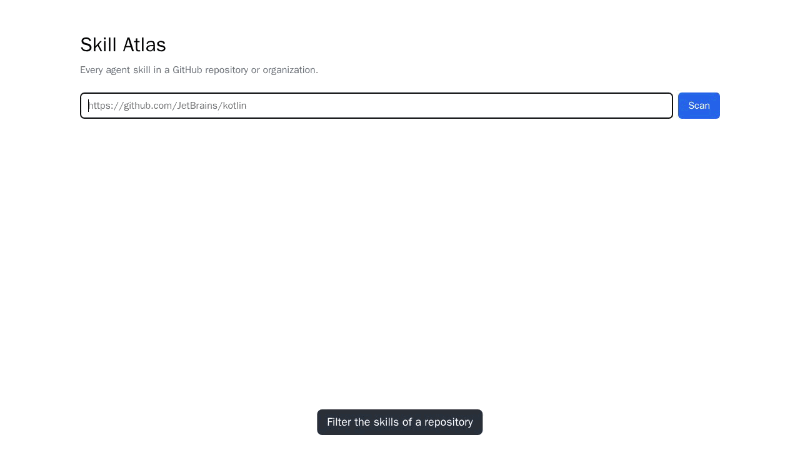

# Skill Atlas

Every agent skill in a repository: `./skill-atlas scan` finds each `SKILL.md` and prints its name,
description and link.

```console
$ npm ci
$ ./skill-atlas scan https://github.com/JetBrains/kotlin
JetBrains/kotlin · 6 skills
…
build-tools-bump-gradle-api — Bumps the Gradle API version that Kotlin Gradle plugins are compiled against in the Kotlin compiler repository.
  https://github.com/JetBrains/kotlin/blob/5ab6270ab772d113e8ad52ebfcaa0109c522ae00/.claude/skills/build-tools-bump-gradle-api/SKILL.md
…
```

Or in the browser: `./skill-atlas serve` opens http://localhost:3000, where you paste a
GitHub repository URL and press *Scan*, or an organization URL to browse its
repositories one by one ([spec/web.md](spec/web.md)). A 35-second video of both,
the filter and an organization: [docs/demo/skill-atlas.webm](docs/demo/skill-atlas.webm)
(`npm run demo` records it again, with its GIF).



Set `GITHUB_TOKEN` for a higher GitHub rate limit. `npm test` runs the offline
tests; `npm run test:browser` drives the web page in headless Chromium (once:
`npx playwright install chromium-headless-shell`); `npm run e2e` plays the demo as screenshot tests, pixel by pixel against the baselines in
[spec/screenshots](spec/screenshots/) (made on Linux; `npm run e2e:linux` anywhere);
`GITHUB_TOKEN=… npm run test:e2e` compares fixed-commit scans of three
real JetBrains repositories with checked-in snapshots.

- [spec/](spec/): what it does. [AGENTS.md](AGENTS.md): the definition of done.
- [fixture/](fixture/README.md): a small repository for the tests.
