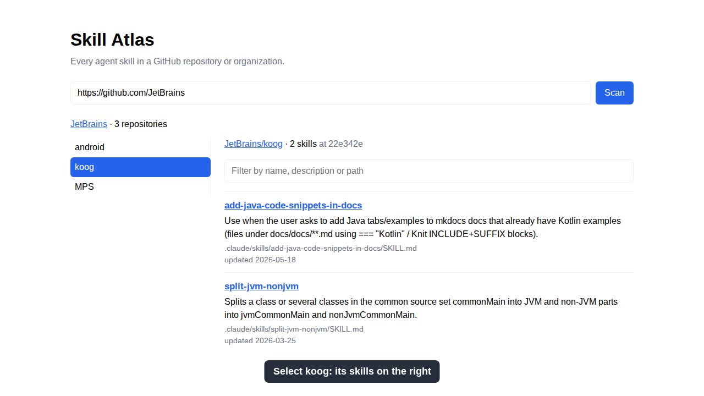

# Web
`./skill-atlas serve [port]` starts the web client on port 3000 by default
(`0`: any free port) and prints `Skill Atlas on http://localhost:<port>`.
Like the CLI, a *thin client* over the core; *nothing is stored*.
`GITHUB_TOKEN`, optional, on the server: as for the CLI.
## Page
`GET /`: paste a **GitHub repository** URL (optionally `/tree/<commit>`), press
*Scan*. The page shows `<owner>/<repo> · N skills`, then each skill's **name**
(linked to its pinned SKILL.md), full **description**, path and `also in`
copies, and `updated YYYY-MM-DD`: the day, in UTC, its SKILL.md last changed as
of the scanned commit; then the warnings. When a repository has no skills, the page says so.
The scanned URL goes into the address bar as `?url=<GitHub URL>`, and opening
such an address scans it at once.

Once a scan finds skills, a filter field shows above them. Typing narrows the
displayed skills, *case-insensitively*, to those whose name, description or
path contains the text. Whitespace is matched as users see it in the page, so
words across a line break are separated by one space. When none match, the page
says so. Clearing the field shows every scanned skill again, *without
rescanning* GitHub. The date is not matched.

The date needs `GITHUB_TOKEN`, like code search: one GitHub request a skill.
Without a token no date shows and nothing else changes. A skill GitHub cannot
date shows none, and one warning says how many: `cannot tell when N skills were
last updated: <the first one's error>`; the scan still succeeds.

### Organization
Paste a **GitHub organization** URL, `https://github.com/<organization>`, instead:
the page shows `<organization> · N repositories`, then the repositories, sorted by
name, in a list on the *left*. Selecting one scans it and shows, on the *right*, its
summary, skills and warnings exactly as for a single repository. The organization
URL goes into the address bar like a repository URL.
States: `Loading repositories…` while the organization is listed, `Scanning…`
while a repository is scanned; `· 0 repositories` (no list) for an empty
organization; GitHub errors in red, for the organization above the list, for a
repository on the right, with the list kept. A late answer from an earlier scan
never replaces the current selection's status or results.
## API
`GET /api/scan?url=<GitHub URL>` answers JSON:
- 200: `{ repository: { id, url, commit }, skills: [{ id, name, description,
  path, link, copies, updated }], warnings }`, skills sorted by **name**;
  `updated`: the ISO date of the last commit to the skill's path at the scanned
  commit, `null` without a token or when GitHub cannot tell
- 400 `{ error }`: not a GitHub repository URL; *local directories are refused*
- 502 `{ error }`: GitHub cannot be scanned (not found, unreachable, rate limit),
  with the CLI's message

`GET /api/organization?url=<GitHub organization URL>` answers JSON:
- 200: `{ id, url, repositories: [{ id, name, url, description }] }`: every
  repository GitHub lists for the organization (all pages of 100), sorted by
  **name**, case-insensitively; public ones only without `GITHUB_TOKEN`
- 400 `{ error }`: not a GitHub organization URL (a repository URL included)
- 502 `{ error }`: GitHub cannot list it; an unknown organization is
  `Organization not found: https://github.com/<organization>`
- Any other path: 404 `{ error }`; other methods than GET/HEAD: 405
## Browser proof
`npm run test:browser` drives the page in headless Chromium with recorded GitHub
answers: scan, `also in`, warnings, HTML in a description shown as text, the
`?url=` address, error messages, the last-updated date: shown, not filtered,
none without a token, a warning when GitHub cannot tell; and the filter:
matching, no matches, clearing;
for an organization, the list on the left, a selected repository's skills on
the right, and the loading, empty and error states.
## Screenshots
What the page looks like is specified by the baselines in
[screenshots/](screenshots/): the key moments of the demo, rendered with the
same data (the JetBrains snapshots, `tests/demo/github.ts`), viewport
(1280×720, light, UTC, en-US) and font (Liberation Sans, bundled) on every
run. `npm run e2e` plays the demo cases (`tests/demo/cases.ts`) in Chromium,
records each on video, and compares each key moment *pixel by pixel*: one
changed pixel fails it (`threshold: 0, maxDiffPixels: 0`), and a test proves so.

| Baseline | The moment |
| --- | --- |
| [start](screenshots/start.png) | the page before a scan |
| [filter-1-scanned](screenshots/filter-1-scanned.png) | JetBrains/MPS scanned: 75 skills, the filter above them |
| [filter-2-description](screenshots/filter-2-description.png) | `youtrack` matches one skill by its description |
| [filter-3-no-match](screenshots/filter-3-no-match.png) | `swift` matches nothing: the page says so |
| [filter-4-cleared](screenshots/filter-4-cleared.png) | the filter cleared: every skill again |
| [organization-1-list](screenshots/organization-1-list.png) | `github.com/JetBrains`: 3 repositories on the left |
| [organization-2-koog](screenshots/organization-2-koog.png) | koog selected: its 2 skills on the right |
| [organization-3-filtered](screenshots/organization-3-filtered.png) | MPS selected, filtered by `kotlin` |

Baselines are made on **Linux, like CI** (Ubuntu 24.04, or
`npm run e2e:linux`, the Playwright image): other systems render text
differently. A change to the page that changes a screenshot updates its
baseline *in the same pull request*: CI fails and lists the changed
screenshots, its `e2e-results` artifact has the expected, actual and diff of
each and every test's video; `npm run screenshots -- accept` takes CI's actual
pixels for the commit as the new baselines; the reviewer compares old and new
in the pull request's image diff and approves. On CI a missing baseline fails
too.
## Demo
`npm run demo` records the same cases, with the same data and font, into
`docs/demo/skill-atlas.webm` and a GIF of it, `skill-atlas.gif`: the filter on
JetBrains/MPS, then the JetBrains organization, one repository at a time
([demo-video](../.agents/skills/demo-video/SKILL.md)).
